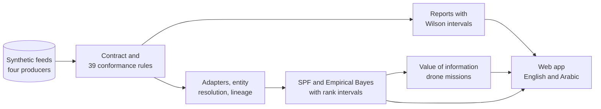

# Sikka (سكّة)

Road crash and traffic data are held by several entities: road authorities, police, emirate level authorities and health services. Each keeps its own formats, identifiers, time conventions and units, so the same crash can be reported several times in different ways, and some crashes are reported by nobody. Public statements on federal roads have named data sharing between entities and the lack of a common framework as challenges ([docs/CONTEXT.md](docs/CONTEXT.md)). Without a shared contract and honest uncertainty, a list of "most dangerous road segments" can reflect who reports what rather than where crashes happen.

Sikka is an open source proposal seed that explores one answer on **synthetic data only**. It defines an open data contract for three feeds (road segments, crash records, traffic station counts), checks feeds from several producers against it with 39 explained rules, harmonises them into one canonical model with lineage for every record, resolves crashes reported more than once (abstaining when the evidence is weak), ranks road segments by potential for safety improvement with Empirical Bayes and rank intervals that account for data quality, and plans drone survey missions where the ranking is least certain. It was prepared by a student and has no endorsement from any entity. Not every part works as hoped: on the synthetic world, Empirical Bayes did not beat a simple crash rate at finding planted blackspots, the data quality step did not widen the rank intervals, and value of information tasking reduced rank uncertainty only slightly. All of this is reported in [docs/EVALUATION.md](docs/EVALUATION.md).

## Run it

Python 3.13 and Node 22 are needed. On Windows (PowerShell), from a clone of this repository:

```
py -3.13 -m venv .venv; .\.venv\Scripts\python -m pip install -r requirements.lock; .\.venv\Scripts\python -m pip install -e . --no-deps
.\.venv\Scripts\sikka serve
npm --prefix web install; npm --prefix web run dev
```

The second command keeps running (it is the live API), so run the third one in a second terminal. Then open http://localhost:5173 (the web app uses port 5173 and stops if it is taken, because the API only accepts that origin). On macOS or Linux use `python3.13 -m venv .venv` and `.venv/bin/` instead of `.\.venv\Scripts\`.

**Static demo** (no backend, deployable on any free static host): `npm --prefix web run build` writes `web/dist`, which reads the precomputed snapshot in `web/public/snapshot` (rebuilt with `sikka snapshot`).

Other commands: `sikka validate FILE` (JSON and HTML report), `sikka generate`, `sikka harmonise`, `sikka eval`, `sikka contract diff v1 v1.1`, `sikka docs build`, `sikka check` (lint, types, import contracts, tests) and `sikka all` (everything).

## How it fits together



Nine layers with import contracts enforced in the fast check: see [docs/ARCHITECTURE.md](docs/ARCHITECTURE.md). Method: [docs/METHOD.md](docs/METHOD.md). Evaluation, with preregistered predictions marked hit or miss: [docs/EVALUATION.md](docs/EVALUATION.md) and [docs/PREREGISTRATION.md](docs/PREREGISTRATION.md).

## What this is not

- **Not real data.** Every crash, count, road, producer and corridor is synthetic and invented. No real personal data is used.
- **Not a deployment** and not an official tool of any entity. It has no endorsement from any entity, and it does not use any government logo, name or colour scheme.
- **Not validated on real roads.** All results hold for the synthetic world only, which was built by the same author as the method ([docs/LIMITATIONS.md](docs/LIMITATIONS.md)).
- **Not a flight plan.** Drone missions are for simulation and review only; real flights need the operator's own safety case and the regulator's approval.
- **Not a final contract.** The contract is a starting point for discussion; [docs/PILOT.md](docs/PILOT.md) describes what a real pilot would need.

## Documentation

| Document | Content |
| --- | --- |
| [CONTRACT](docs/CONTRACT.md) | Field dictionary, generated from the contract models |
| [RULES](docs/RULES.md) | Rule catalogue with failing and passing examples |
| [ARCHITECTURE](docs/ARCHITECTURE.md) | Layers, data flow, deployment and the validate sequence |
| [METHOD](docs/METHOD.md) | Conformance, harmonisation, ranking and tasking |
| [PREREGISTRATION](docs/PREREGISTRATION.md) | Predictions committed before any result |
| [EVALUATION](docs/EVALUATION.md) | Results rendered from `results/*.json` |
| [LIMITATIONS](docs/LIMITATIONS.md) | What the results do not show |
| [PILOT](docs/PILOT.md) | What a real pilot would need (proposal) |
| [SECURITY](docs/SECURITY.md) | Threat model, upload limits, dependency audit |
| [DATA_STATEMENT](docs/DATA_STATEMENT.md) | What data the repository holds and how it was made |
| [DECISIONS](docs/DECISIONS.md) and [adr/](docs/adr) | Choices made during the build |

## Licence

Apache License 2.0 ([LICENSE](LICENSE), [ADR 0001](docs/adr/0001-licence.md)).

## Contact

Repository owner: [hudasol](https://github.com/hudasol). LinkedIn: https://www.linkedin.com/in/huda-mueen-73bba6363/. Email: hudamueen2407@gmail.com.
