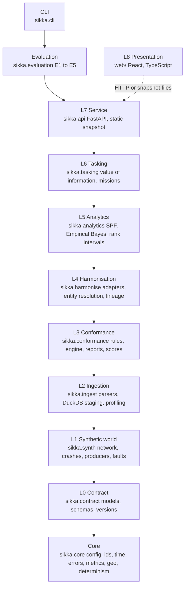
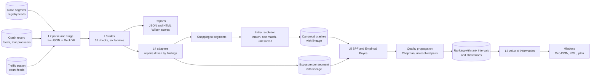
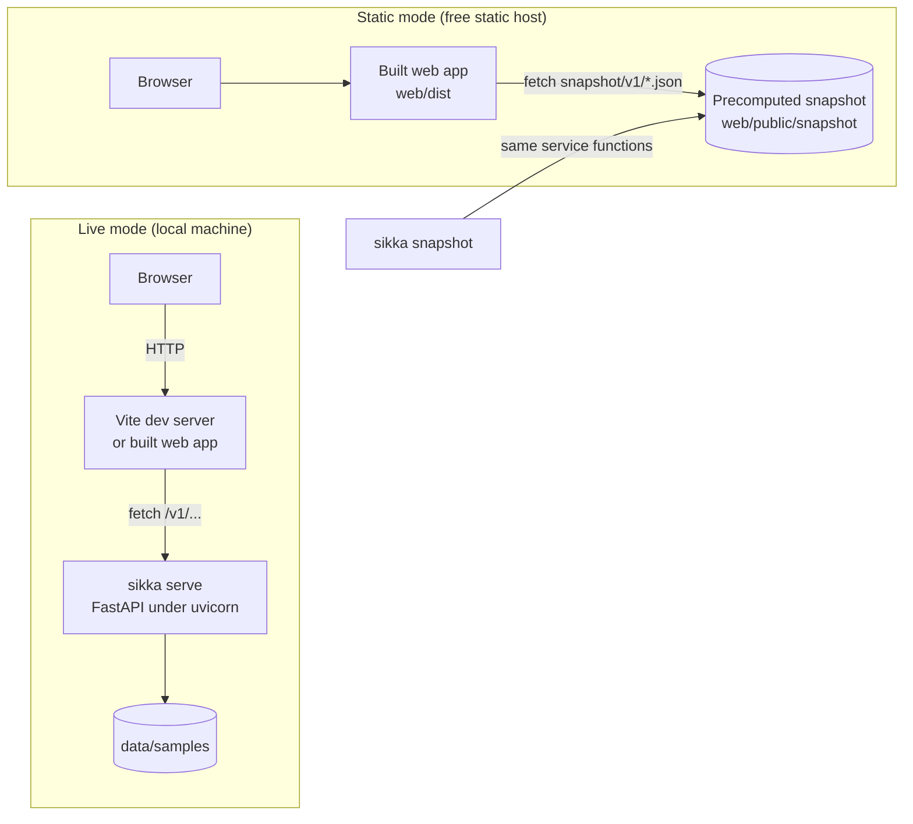
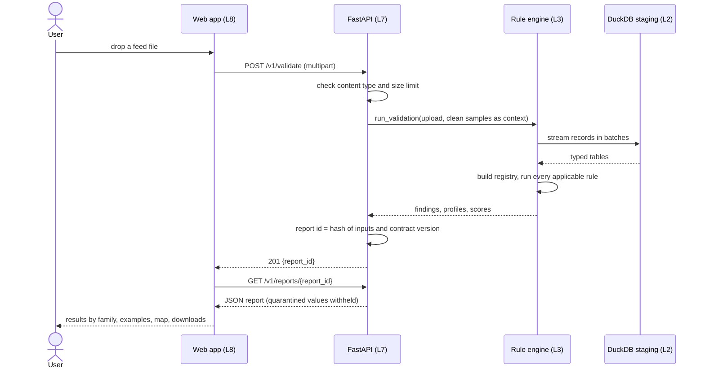

# Architecture

Sikka is organised in nine layers plus a cross cutting core. Dependencies point downward only: a layer may import the layers below it and never the layers above. Two import contracts in `pyproject.toml`, checked by `import-linter` inside `sikka check`, enforce this, and a second contract forbids the product layers (L2 to L7) from importing the synthetic world, so the hidden ground truth can only reach the evaluation harness.

All data in this repository is synthetic.

## Layers

| Layer | Package | Public interface (examples) |
| --- | --- | --- |
| Core | `sikka.core` | `rng`, `stable_json_dumps`, `wilson_interval`, `parse_utc`, `Paths`, error classes |
| L0 | `sikka.contract` | `RoadSegment`, `CrashRecord`, `TrafficCount`, `version_schemas`, `diff_versions` |
| L1 | `sikka.synth` | `build_world`, `inject`, `CATALOGUE`, `write_world` |
| L2 | `sikka.ingest` | `open_text`, `stage`, `profile_feed` |
| L3 | `sikka.conformance` | `run_validation`, `build_report`, `REGISTRY`, `render_rules_md` |
| L4 | `sikka.harmonise` | `harmonise`, `HarmonisedDataset`, `resolve`, `Lineage` |
| L5 | `sikka.analytics` | `rank_dataset`, `fit_spf`, `empirical_bayes`, `rank_stability` |
| L6 | `sikka.tasking` | `plan_missions`, `compare_strategies`, `to_plan`, `validate_plan` |
| L7 | `sikka.api` | `create_app`, `Service`, `snapshot_files` |
| Evaluation | `sikka.evaluation` | `run_experiments`, `PREDICTIONS`, `render_evaluation` |

The evaluation harness sits above the service layer because it needs the synthetic world and its truth, which the product layers may not import. The command line interface is the single entry point (`sikka`).

## Data flow

## Deployment

In static mode uploads are disabled; every other screen works from the snapshot. No request leaves the product in either mode: fonts are self hosted, maps use no tiles, and there is no analytics.

## Sequence: validating an upload

## Design rules

- **Contract first.** L0 is the single source of truth; JSON Schema, the field dictionary, the TypeScript types and the API models are generated from it, and a test fails when a generated file is stale.
- **Determinism.** Every random step takes an explicit seed and a named stream (ADR 0002); the same inputs give the same bytes.
- **Pure core, thin edges.** Rules and analytics are functions over DuckDB tables or data frames; file and network I/O happen in L2 and L7.
- **Explainability.** Every finding names its rule, row and field; every canonical record carries its lineage; every rank carries its interval and a structured explanation.
